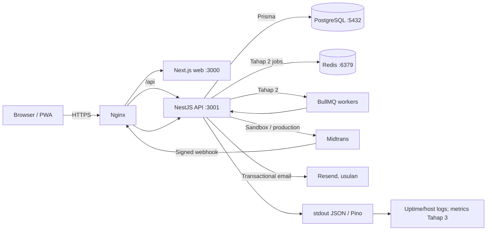

# Arsitektur TMS

## Gambaran

Monorepo npm workspaces dengan web publik/admin Next.js dan API NestJS terpisah. PostgreSQL adalah sumber kebenaran untuk booking, kuota, dan pembayaran. Pada Tahap 1 scheduler NestJS berjalan tanpa Redis; Tahap 2 menambahkan Redis/BullMQ untuk job yang membutuhkan retry/queue lintas proses.



## Struktur monorepo yang direncanakan

```text
apps/
  web/                 # Next.js routes, server components, admin/customer UI
  api/                 # NestJS modules and HTTP API
packages/
  shared/              # shared DTO-independent types/constants when genuinely shared
docs/
  ...
```

Workspace root memakai npm workspaces; versi Node yang ditargetkan Node.js v24. Jangan membuat shared package hanya untuk satu pemakai. Antarmuka NestJS menjadi batas validasi dan otorisasi; web tidak mengakses database langsung.

## Modul NestJS yang direncanakan

- `AuthModule`: login, access JWT, refresh token rotation/revocation, cookies, RBAC guards.
- `UsersModule`: admin/user/role, provisioning dan audit.
- `DestinationsModule`, `TripsModule`, `SchedulesModule`: konten publik dan administrasi; `Destination` memakai parent-child, sedangkan `TripDestination` menyimpan relasi banyak-ke-banyak, urutan dan lokasi utama.
- `BookingsModule`: validasi checkout, transaksi kapasitas, lookup status.
- `PaymentsModule`: Payment records, Midtrans create/status integration, anomaly review.
- `WebhooksModule`: validasi signature, inbox/idempotency, Status API reconciliation.
- `NotificationsModule`: email adapter, delivery records dan retry.
- `ReportsModule`: manifest dan ringkasan admin.
- `AuditModule`: event audit untuk mutasi sensitif.
- `HealthModule`: liveness/readiness.
- `SchedulerModule`: Stage 1 expiry/reminder; proses handler harus idempoten.

## Alur auth dan refresh token

1. Admin login; API memverifikasi Argon2id (pilihan awal) atau bcrypt hash dan menerbitkan JWT access berumur pendek.
2. Refresh token acak berentropi tinggi hanya dikirim sebagai cookie `httpOnly`, `Secure` pada HTTPS, `SameSite=Lax`/kebijakan yang diuji, scope/path sempit.
3. Database menyimpan hash refresh token, user/session, expiry, dan keluarga/versi rotasi; plaintext tidak disimpan/log.
4. Endpoint refresh memvalidasi cookie dan status, mencabut token lama, menyimpan hash token baru secara atomik. Penggunaan token lama menandai reuse dan mencabut keluarga sesi.
5. Logout mencabut token aktif server-side dan menghapus cookie. Ganti password/revoke admin mencabut semua sesi terkait.
6. Karena cookie otomatis terkirim browser, mutasi memeriksa Origin/CSRF token sesuai desain. CORS hanya origin web resmi.

Detail konfigurasi dan threat model ada di `SECURITY.md`.

## Kapasitas, booking, dan pembayaran

Satu transaksi DB memvalidasi status jadwal, mengunci row `TripSchedule` (atau serializable strategy teruji), menghitung kapasitas aktif, membuat booking/participant dan hold, lalu commit. Status/kuota tidak diubah dari nilai stale yang dibaca sebelum transaksi. Area yang dipilih customer/admin mengacu ke record `Destination`, bukan konstanta kota; query untuk area induk mencakup trip yang terkait ke turunannya. Payment, webhook inbox, dan transisi state menggunakan unique constraint/idempotency serta conditional update. Pengembalian kuota hanya sekali.

Tahap 1 scheduler NestJS mengecek hold kedaluwarsa; scheduler dapat hidup di API tunggal. Saat menjalankan beberapa instance, distributed locking/job queue menjadi prasyarat untuk tugas lintas instance. Tahap 2 Redis + BullMQ menyediakan retry dan worker; PostgreSQL tetap sumber kebenaran, job dapat diproses ulang.

## Cache dan antrean

Belum ada Redis Tahap 1. Cache hanya untuk konten publik yang aman/stale; jangan cache keputusan kuota, booking, payment, session atau data pribadi. Redis pada Tahap 2 digunakan untuk BullMQ dan cache publik bila terbukti perlu, dengan TTL/namespace dan persistence sesuai kebutuhan; pekerjaan yang tidak terkirim tetap dapat dideteksi lewat data DB/outbox.

## Laptop, VPS, dan database

- **Laptop Windows:** Docker tidak terdeteksi di PATH saat Tahap 0. Pilihan sederhana: installer resmi PostgreSQL untuk Windows karena hanya database utama yang diperlukan pada Tahap 1 dan developer tidak perlu membangun/mengelola container. Jalankan service lokal dengan akses loopback; jangan ubah pengaturan sistem otomatis. Redis ditunda sampai Tahap 2.
- **Tahap 2 lokal:** bila Docker Desktop tersedia dan pemilik memilihnya, compose untuk Redis boleh ditambahkan; bila tidak, gunakan distribusi Redis-compatible yang disetujui dan didukung Windows atau lingkungan WSL. Pilihan final `TBD` setelah kebutuhan queue diverifikasi.
- **Server:** VPS Ubuntu 24.04; Node.js v24, PostgreSQL, Nginx, systemd. Redis dipasang ketika Tahap 2 digunakan. Pertahankan sisa disk sekitar 28 GB dengan log rotation, backup eksternal, pemantauan ruang dan batas retensi.
- API/web bind ke loopback di belakang Nginx. Port DB/Redis tidak dibuka ke internet.

## Port lokal

| Layanan | Port | Tahap / akses |
|---|---:|---|
| Next.js | 3000 | web lokal / loopback server |
| NestJS | 3001 | API lokal / loopback server |
| PostgreSQL | 5432 | lokal saja; VPS loopback |
| Redis | 6379 | Tahap 2, lokal saja; VPS loopback |
| Nginx HTTP/HTTPS | 80/443 | VPS, publik |

## Environment dan konfigurasi

- `.env` lokal di-ignore Git; `.env.example` hanya nama variabel dengan nilai kosong. Jangan menaruh secret di argumen command, source, log, screenshot, atau docs.
- Aplikasi memvalidasi env saat boot dan berhenti dengan pesan yang menyebut nama variabel hilang (tanpa nilai secret).
- Pisahkan env web dan API sesuai pemakai; browser hanya mendapat `NEXT_PUBLIC_*` yang memang publik. Server key Midtrans dan email key hanya ada pada API.
- Produksi menggunakan file environment di luar checkout dengan izin ketat (`0600`, owner service), atau secret manager bila disetujui.

## Backup dan pemulihan

Gunakan `pg_dump` custom-format harian dengan retensi yang dikonfigurasi, terenkripsi sebelum dikirim ke storage di luar VPS. Backup bukan bukti recovery sampai uji restore berhasil. Catat RPO/RTO yang disepakati sebelum go-live (`TBD` pemilik); detail jadwal dan restore drill ada di `DEPLOY_RUNBOOK.md`.

## Logging dan observability

Pino mengirim JSON ke stdout; systemd/journald mengelola log lokal dengan batas/retensi. Correlation/request ID pada API; redaksi authorization, cookie, token, webhook secret, email/telepon dan payment data. Health endpoint memisahkan liveness dan readiness DB. Uptime Kuma untuk tahap awal; Prometheus + Grafana tahap 3. Alert untuk API/DB down, disk hampir penuh, backup gagal, webhook/reconciliation anomaly, dan antrean tertahan.
# Implementasi fondasi (Tahap 1)

Monorepo memakai npm workspaces: `apps/web` (Next.js), `apps/api` (NestJS) dan `packages/shared` (kontrak role). API menggunakan Prisma 7 dengan adapter PostgreSQL (`pg`). Schema awal memuat `User`, `Role`, `UserRole` dan `RefreshToken`; migrasi berada di `apps/api/prisma/migrations`.

API membaca environment melalui skema Zod saat boot. Admin awal diprovisikan dengan `INITIAL_ADMIN_EMAIL` dan `INITIAL_ADMIN_PASSWORD`; seed Argon2id hanya membuat user baru, tidak mereset password, dan tidak menaikkan role akun non-admin yang sudah ada. Jangan menyimpan `.env` ke Git.

Autentikasi tersedia pada `/api/v1/auth/login`, `/refresh`, `/logout` dan `/me`. Refresh token adalah nilai opaque yang hanya diberikan dalam cookie HttpOnly; database hanya menyimpan SHA-256 hash. Role authorization dilakukan pada API.
